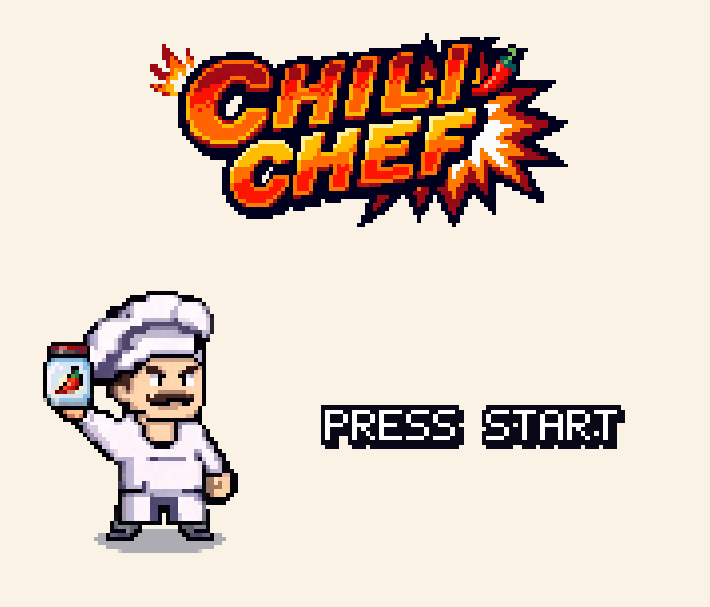

# Chili Chef



A Game Boy style 2D game made in C++ and OpenGL for the Videojocs course (FIB, UPC).

**▶ Play it in your browser: https://alexmanzaneda.github.io/chili-chef/**

## The game

Defeat all the enemies and reach the door before time runs out. Place chili bombs to break boxes
and blow up the peas, toasters and flames across three worlds (kitchen, fridge and oven), up to
the oven boss. The boxes hide power-ups, and you keep them in the next level.

| Action          | Keyboard          | Gamepad          |
|-----------------|-------------------|------------------|
| Move            | ← →               | D-pad / left stick |
| Jump            | ↑ / Z             | A                |
| Bomb            | Space             | B / X            |
| Pause / confirm | Enter             | Start            |
| Back            | Esc               | Back / Select    |

On phones and tablets the web version shows touch controls: a Game Boy layout in portrait
(screen on top, D-pad and A / B below) and the D-pad and A / B on the sides in landscape.
The camera also zooms in (11 x 11 tiles instead of 15 x 15, `MOBILE_ZOOM` in `Game.h`) and
follows the chef, so the game is easier to see on a small screen.
Add `?touch` to the URL to see all this on a computer.

| Power-up   | Effect            |
|------------|-------------------|
| Bomb up    | +1 bomb (max 8)   |
| Fire up    | +1 range (max 4)  |
| Shield     | Survives one hit  |
| Extra life | +1 life (max 9)   |
| Timer      | +30 seconds       |
| Full fire  | Maximum range     |

## Build and run (desktop)

1. Open `game/chili-chef.sln` in Visual Studio (File → Open → Project/Solution, not "Open Folder").
2. Choose `Debug|Win32` or `Release|Win32` and press F5.

`glew32.dll` is copied next to the executable automatically when building.

## Web version

The game is also compiled to WebAssembly + WebGL 2 with [Emscripten](https://emscripten.org) and published to
GitHub Pages on every push to `main` (`.github/workflows/pages.yml`).

To build it locally (with `emcc` in the PATH):

```bash
bash web/build.sh                   # builds into dist/
python -m http.server 8080 -d dist  # then open http://localhost:8080
```

Opening `dist/index.html` directly does not work: the browser only loads the game files (`index.data`) over HTTP.
After a rebuild, reload with Ctrl+Shift+R so the browser does not keep the old `index.wasm`.

The differences from the desktop build are inside `#ifdef __EMSCRIPTEN__`:

- The shaders are turned into GLSL ES 3.00 when they are loaded (`Shader.cpp`).
- The browser runs the loop (`main.cpp`). The loop runs a fixed 60 updates per second whatever the screen
  refresh rate, because the movement of the game is per update.
- The menu has no EXIT option.

The page around the canvas is `web/shell.html`.

## Project structure

```
game/       Visual Studio solution
  src/      Source code (.cpp/.h)
  images/   Textures loaded by the game
  levels/   Level maps
  shaders/  GLSL shaders
  sounds/   Sound effects (.wav, generated with tools/make_sounds.py)
  music/    Background music (.wav, generated with tools/make_music.py)
libs/       External libraries (GLFW, GLEW, GLM, SOIL, FreeType, miniaudio)
art/        Source art (.xcf, Tiled maps .tmx/.tsx)
tools/      Scripts that generate images, levels, sounds and music
web/        Build script and page of the web version
docs/       README images
```

## Audio

Audio uses [miniaudio](https://miniaud.io): a single header in `libs/`, public domain, no DLLs.
Everything goes through the `Audio` class (`src/Audio.h`):

```cpp
Audio::instance().playSound(SOUND_EXPLOSION); // Short effect, several can overlap
Audio::instance().playMusic(MUSIC_KITCHEN);   // Looping background track, only one at a time
```

- **Adding an effect:** its id in `SoundId` (`Audio.h`), its file in `SOUND_FILES` (`Audio.cpp`), and its
  function in `tools/make_sounds.py` (or your own .wav in `game/sounds/`).
- **Music:** the files in `MUSIC_FILES` (`game/music/menu.wav`, `kitchen.wav`, `fridge.wav`, `oven.wav`).
  `tools/make_music.py` generates them from notes written in the script (placeholders). To replace one, drop in
  another .wav with the same name (for example, exported from BeepBox). They are WAV and not MP3 because MP3
  adds silence at the start and end, and the loop would skip.
  Each world picks its track in `Levels.h`. If a file is missing, the game says so in the console and goes on
  without it.

## Credits

Programming and art: Alex Manzaneda and Sara Vidal.
Based on Pocket Bomberman (1998). Made for Videojocs, FIB UPC, 2026/27.

Released under the [MIT License](LICENSE).
